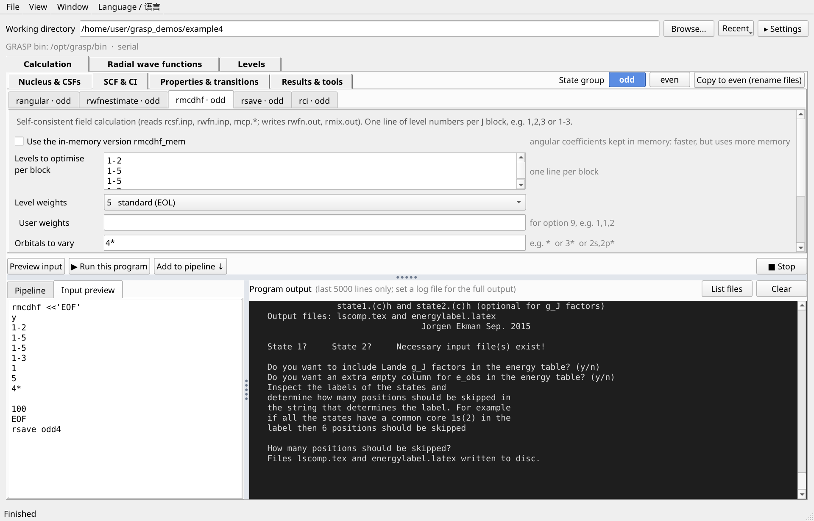
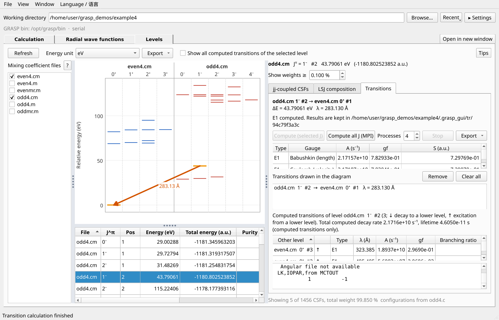
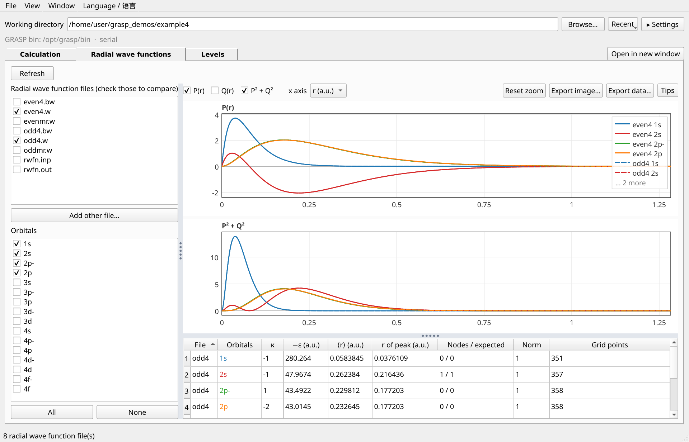
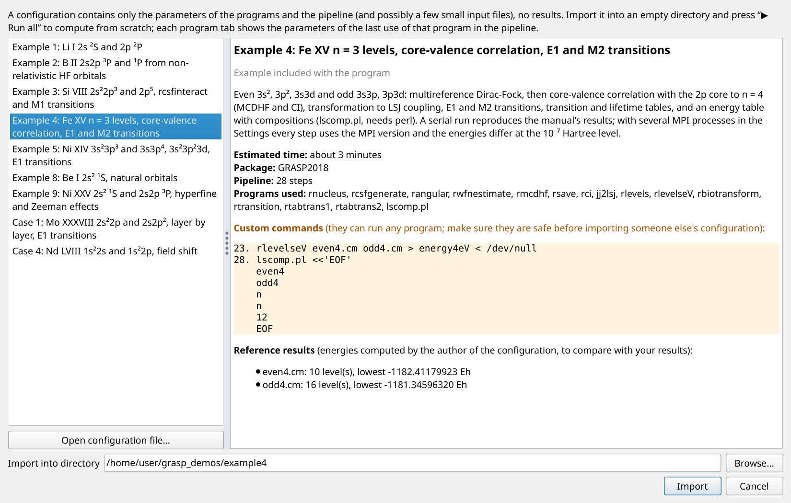
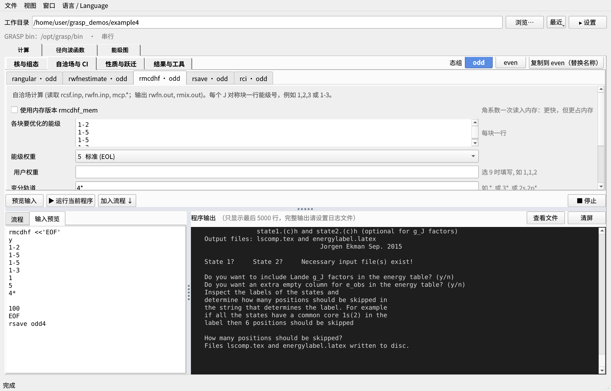
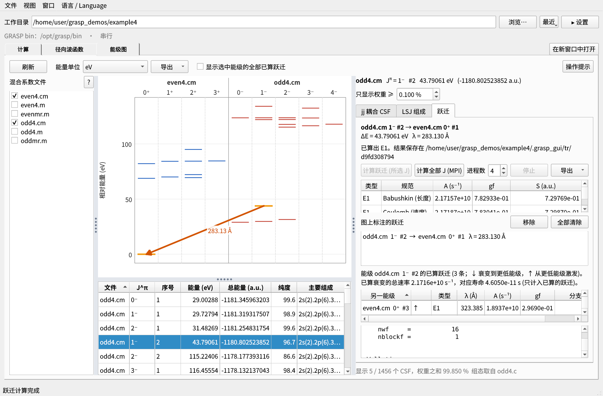
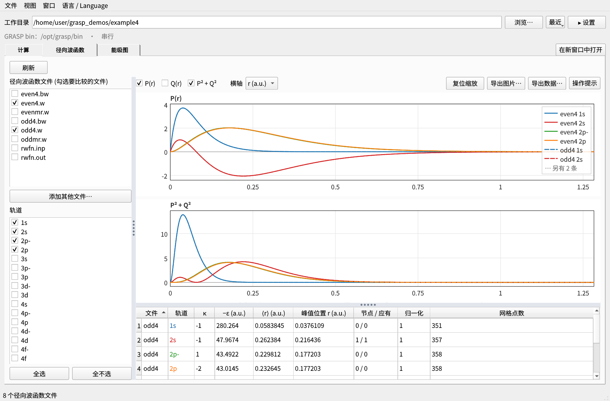
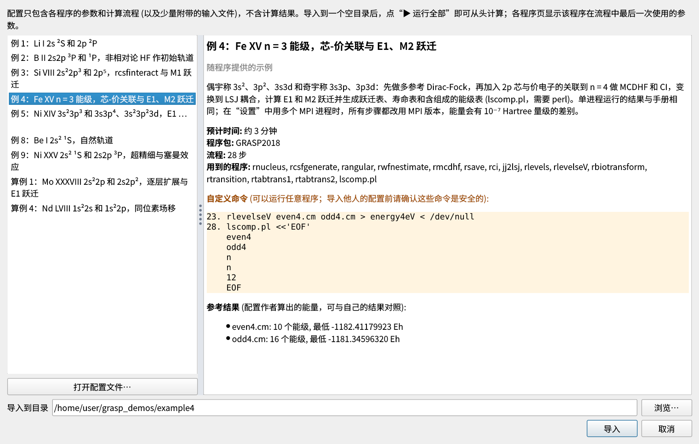

# GRASP GUI

A graphical interface for [GRASP2018](https://github.com/compas/grasp): fill in the parameters of each
program, and the GUI generates the interactive input (stdin) and runs the program in a working directory.
The interface is available in Chinese and English.

GRASP2018 的图形界面：在表单中填写各程序的参数，界面自动生成交互输入 (stdin)，并在工作目录中运行。
界面支持中文和 English。

**Download / 下载**: standalone Linux executables (no Python needed) on the
[Releases page](https://github.com/skq1998/grasp_gui/releases/latest): `grasp_gui-linux-x86_64` for desktops
(glibc ≥ 2.35), `grasp_gui-legacy-linux-x86_64` for old servers and `ssh -X` (glibc ≥ 2.17).
在 [Releases 页面](https://github.com/skq1998/grasp_gui/releases/latest) 下载独立可执行文件 (不需要 Python)：
桌面电脑用 `grasp_gui-linux-x86_64` (glibc ≥ 2.35)，旧服务器和 `ssh -X` 用 `grasp_gui-legacy-linux-x86_64` (glibc ≥ 2.17)。

## Screenshots / 截图

The screenshots show example 4 of the GRASP2018 manual (Fe XV), imported with *File → Import example…* and run
with *▶ Run all*. / 截图为 GRASP2018 手册的算例 4 (Fe XV)：用“文件 → 导入示例…”导入，点“▶ 运行全部”计算。

**Calculation** — one form per program, odd / even state groups, the pipeline and the generated input (here
`rmcdhf`, followed by `rsave`):



**Levels** — drag from one level to another to compute the transition (`rbiotransform` and `rtransition` run
automatically); the result is drawn as an arrow with its wavelength, with A, gf, S, branching ratio and lifetime:



**Radial wave functions** — P(r), Q(r) and P² + Q² of several `.w` files overlaid, with orbital properties:



**Examples and shared configurations** — what a configuration does, the programs it needs, every custom command
(highlighted) and reference energies, before importing:



<details>
<summary>中文界面 (Chinese interface)</summary>

**计算**：每个程序一个参数页，odd / even 态组，计算流程和自动生成的输入 (这里是 `rmcdhf`，之后运行 `rsave`)：



**能级图**：从一个能级拖到另一个能级即可计算跃迁 (自动运行 `rbiotransform` 和 `rtransition`)，结果画成标有波长的箭头，
并列出 A、gf、S、分支比和寿命：



**径向波函数**：叠加多个 `.w` 文件的 P(r)、Q(r) 和 P² + Q²，并列出轨道性质：



**示例与共享配置**：导入前显示配置的说明、所需的程序、全部自定义命令 (醒目标出) 和参考能量：



</details>

## Features / 功能

- **Main window**: the working directory and the run settings (GRASP `bin`, MPI) at the top, below three tabs:
  *Calculation*, *Radial wave functions* and *Levels*. The viewers show the working directory and are refreshed when
  a run finishes; *Open in new window* shows a viewer in a separate window with its own directory (e.g. to
  compare with another calculation). Directories and files can be dropped onto the viewers, and
  `grasp_gui levels`, `grasp_gui wfn` or `grasp_gui FILE` open the GUI directly on a viewer (see *Usage*).

- **Examples** (*File → Import example…*): the examples of the GRASP2018 manual (example1–5, 8, 9, case1 and
  case4) as ready-made pipelines. An example is imported into an empty directory with all parameters and the
  whole pipeline; press *▶ Run all* to compute it from scratch. The dialog shows what each example does, its
  running time, the programs it needs and the reference energies of the manual's results.
- **Shared configurations** (*File → Export configuration…* / *Import configuration file…*): save the current
  pipeline with the parameters of every step as one JSON file — no results and no machine-specific settings —
  optionally with a description, reference energies and small text input files. Others import it into an empty
  directory and repeat the calculation; the program input is regenerated by the importing GUI. Before importing,
  the dialog shows the programs needed, compatibility warnings and every custom command, which must be confirmed.
  The manual examples use the same format; see [docs/CONFIG_FORMAT.md](docs/CONFIG_FORMAT.md).

- One tab per program: `rnucleus`, `rcsfgenerate`, `rcsfinteract`, `rcsfsplit`, `rangular`, `rwfnestimate`,
  `rmcdhf`, `rsave`, `rci`, `jj2lsj`, `rhfs` (optionally followed by `rhfs_lsj`), `ris4`, `rlevels`,
  `rtablevels`, `rtabtrans1`, `rtabtrans2`, `rbiotransform`, `rtransition`, plus a *Custom* tab (grouped as *Nucleus & CSFs*, *SCF & CI*,
  *Properties & transitions*, *Results & tools*) for any other program with hand-written input. Inputs follow the
  default-settings question order of each program; they reproduce the inputs of the test cases in
  `grasptest/` (case1–4, example1–5, 8, 9) except non-default `jj2lsj` runs, which need the *Custom* tab.
- Common file steps are built in: save `rcsf.out` as `name.c`, copy a `.c` file to `rcsf.inp` before
  `rangular`, run `rsave` after `rmcdhf`, copy `.c/.w` before `rci`.
- **Pipeline**: add several steps, run them in order (stops at the first error), preview the input, and
  export as a shell script.
- **MPI**: with more than one process, `rangular`, `rmcdhf`, `rci`, `rbiotransform` and `rtransition` run as
  `mpirun -np N <prog>_mpi` (with `MPI_TMP`). `rmcdhf` can use the in-memory version
  `rmcdhf_mem` / `rmcdhf_mem_mpi`.
- **Slurm**: export the pipeline as a job script for `sbatch` (partition, nodes, tasks, time, memory,
  modules, e-mail, extra `#SBATCH` options).
- **State groups odd / even**: `rcsfgenerate`, `rcsfinteract`, `rcsfsplit`, `rangular`, `rwfnestimate`,
  `rmcdhf`, `rsave`, `rci`, `jj2lsj`, `rhfs` and `ris4` keep separate parameters for each group
  (file names such as `odd2.c` / `even2.c`,
  `outodd_rci` / `outeven_rci` correspond automatically); the other tabs are shared. *Copy to …* copies
  the current group to the other one and renames the files.
- **Per-directory session**: parameters, groups and the pipeline are saved automatically in
  `<working directory>/.grasp_gui.json` and restored when the directory is opened again. On start the GUI
  opens the directory used last time.
- Save / load all parameters and the pipeline as JSON.
- **Radial wave functions** (tab): reads the `.w`
  files of the working directory and plots P(r), Q(r) and P² + Q² on an r, log r or √r axis; several files can
  be overlaid (e.g. `odd2.w` … `odd6.w`), each orbital in one colour and each file in one line style. A table
  lists orbital energies, ⟨r⟩, peak position, nodes (vs. n − l − 1) and norms. Export as PNG or CSV.
  Files are recognised by their content, not their name, so `rwfn.inp`, `rwfn.out` and renamed files are found too.
- **Levels and compositions** (*Levels* tab): reads the mixing
  coefficient files (`.m`, `.cm`) and draws an energy level diagram, one column per J^π (odd parity red, even
  blue). Hover a level for details, click it (or a row of the level list) to see the composition of the ASF:
  the jj-coupled CSF mixing coefficients with configurations from the `.c` file, and the LSJ composition from
  `jj2lsj` (`.lsj.lbl`). Energies relative to the lowest level in eV (default), cm⁻¹ or atomic units; the choice is remembered.
  The matching `.c` and `.lsj.lbl` files are found by content (number of orbitals, CSFs and J^π of each block;
  energies of the levels), so they need not share the name of the mixing file.
- **Transitions on demand** (*Levels* tab): drag from one level to another (or Shift-click a second level)
  and press *Compute (selected J)*. Nothing has to be prepared beforehand: the GUI runs `rbiotransform` (the
  biorthogonal transformation, skipped when both levels come from the same file) and `rtransition` for the
  multipoles allowed between the two levels (E1, or M2 when E1 is forbidden; M1 and E2 between levels of the
  same parity). By default only the J^π symmetries of the two levels are computed (the GUI writes `.c` / `.cm`
  files with just those blocks), using the process count of the main window; *Compute all J (MPI)* computes
  all transitions between the two files (for lifetimes and branching ratios) with the MPI programs and the
  process count set next to it. All levels within the computed symmetries are done at once, so other pairs
  there are shown immediately; the results (A, gf, S in the Babushkin and Coulomb gauges) are kept in
  `<working directory>/.grasp_gui/tr/` and reused until an input file changes.
  Each computed transition you connect is drawn as an arrow labelled with its wavelength (right-click an
  arrow to remove it); the arrows are kept per working directory. A table lists all computed transitions of
  the selected level with branching ratios (optionally also drawn in the diagram).
- **Export** (*Levels* tab): the level diagram as PDF (fonts embedded), SVG or PNG, labelled with configuration
  and term (e.g. [Ne]3s3p ¹P°₁; J^π when there is no jj2lsj result) and the marked transitions; level data
  and transitions as CSV (UTF-8, NIST-style configurations such as `[Ne]3s.3p` and terms such as `1P*`); the
  computed transitions as a GRASP file (`even4.odd4.ct`) for `rtabtrans1` / `rtabtrans2`. Configuration
  abbreviations (default: noble-gas cores [He] … [Rn]) can be edited; core orbitals of the CSF file are included.

**主窗口**：上方是工作目录和运行设置 (GRASP `bin`、MPI)，下面三个标签页：计算、径向波函数、能级图。查看器显示工作目录中的结果，
计算完成后自动刷新；“在新窗口中打开”在单独的窗口中显示查看器，可以看另一个目录 (例如与另一次计算对照)。可以把目录或文件拖到查看器上；
`grasp_gui levels`、`grasp_gui wfn` 或 `grasp_gui 文件` 直接打开对应的页 (见“用法”)。
**示例**（“文件 → 导入示例…”）：GRASP2018 手册中的算例 (example1–5、8、9，case1、case4) 做成现成的流程，
导入到一个空目录后带有全部参数和计算流程，点“▶ 运行全部”即可从头计算。对话框中有各示例的说明、所需时间、
用到的程序，以及手册算例结果的参考能量，便于对照。
**共享配置**（“文件 → 导出配置…” / “导入配置文件…”）：把当前流程连同各步的参数保存为一个 JSON 文件 (不含计算结果和
与机器有关的设置)，可附上说明、参考能量和少量文本输入文件。别人导入到空目录后即可重复这个计算，程序输入由导入方的界面重新生成。
导入前对话框列出所需的程序、兼容性提示和全部自定义命令 (需要确认)。手册算例也采用这个格式，见 [docs/CONFIG_FORMAT.md](docs/CONFIG_FORMAT.md)。
**态组 odd / even**：上述 11 个程序页按态组分别保存参数，文件名自动对应，其余程序页两组共用；
“复制到 …”把当前组的参数复制到另一组并替换名称。
**工作目录记录**：参数、态组和流程自动保存在 `工作目录/.grasp_gui.json`，再次打开该目录时自动恢复；
启动时打开上次使用的目录。
**径向波函数**（标签页）：读取工作目录中的 `.w` 文件，绘制 P(r)、Q(r)
和径向密度 P² + Q²，可叠加多个文件比较；表格列出轨道能量、⟨r⟩、峰值位置、节点数和归一化；可导出 PNG 或 CSV。按文件内容识别波函数文件，与文件名无关 (`rwfn.inp`、`rwfn.out` 或改过名的文件也能找到)。
**能级与组成**（“能级图”标签页）：读取混合系数文件 (`.m`、`.cm`) 画出能级图，
每个 J^π 一列；鼠标停在能级上显示信息，点击能级 (或能级列表中的一行) 显示该原子态的组成：jj 耦合下的 CSF
混合系数 (组态来自 `.c` 文件) 以及 jj2lsj 给出的 LSJ 组成 (`.lsj.lbl`)。能量相对于最低能级，默认用 eV，可切换为 cm⁻¹ 或原子单位，并记住选择。对应的 `.c` 和 `.lsj.lbl` 文件按内容匹配 (轨道数、各块的 CSF 数与 J^π，以及能级能量)，不要求与混合系数文件同名。
**计算跃迁**（“能级图”标签页）：从一个能级拖到另一个能级 (或按住 Shift 点击第二个能级)，再点“计算跃迁 (所选 J)”。
不需要事先准备：界面自动运行 `rbiotransform` (双正交变换；两个能级来自同一个文件时跳过) 和 `rtransition`，
跃迁类型按两个能级的 J 和宇称选择 (E1，E1 禁戒时为 M2；同宇称为 M1 和 E2)。默认只算两个能级所在的 J^π
(界面写出只含这些块的 `.c`、`.cm`)，进程数沿用主窗口；“计算全部 J (MPI)”算两个文件之间的全部跃迁 (用于寿命和分支比)，
用 MPI 版本和旁边设置的进程数。计算范围内的所有能级一次算完，之后点其中其他能级对可直接显示；结果 (Babushkin 和 Coulomb 两种规范下的
A、gf、S) 保存在 `工作目录/.grasp_gui/tr/` 中，输入文件不变就一直沿用。连上并算好的跃迁画成带波长的箭头 (右键点箭头移除)，按工作目录保存；表格列出选中能级的全部已算跃迁及分支比 (也可在图上显示)。
**导出**（“能级图”标签页）：能级图导出为 PDF (嵌入字体)、SVG 或 PNG，标注组态和谱项 (如 [Ne]3s3p ¹P°₁；没有 jj2lsj 结果时标 J^π) 以及图上标注的跃迁；
能级数据和跃迁导出为 CSV (UTF-8，组态用 NIST 写法如 `[Ne]3s.3p`，谱项如 `1P*`)；已算跃迁可保存为 GRASP 文件 (如 `even4.odd4.ct`)，
直接交给 `rtabtrans1` / `rtabtrans2`。组态缩写规则可编辑 (默认为惰性气体原子实 [He] … [Rn])，CSF 文件中的核心轨道计入组态。

## Requirements / 依赖

- Python ≥ 3.9 and PySide6: `pip install -r requirements.txt`
- A compiled GRASP2018 (`bin/` with `rmcdhf`, …; the `*_mpi` programs and an MPI library for parallel runs)

## Usage / 用法

```bash
python3 grasp_gui.py                  # 中文界面，打开上次的工作目录
python3 grasp_gui.py path/to/workdir  # 打开指定的工作目录 / open this working directory
python3 grasp_gui.py --lang en        # English interface
python3 grasp_gui.py levels [dir]     # 直接打开能级图页 (默认为当前目录) / open on the Levels tab
python3 grasp_gui.py wfn [dir]        # 直接打开径向波函数页 / open on the Radial wave functions tab
python3 grasp_gui.py even4.cm         # 按文件内容打开对应的页，只勾选这个文件 / open the page for this file
python3 grasp_gui.py --help
```

A symbolic link named `grasp_levels` or `grasp_wfn` opens that tab directly, e.g. for the standalone executable:

以 `grasp_levels` 或 `grasp_wfn` 为名的符号链接直接打开对应的页，例如：

```bash
ln -s ~/bin/grasp_gui-linux-x86_64 ~/.local/bin/grasp_gui
ln -s ~/bin/grasp_gui-linux-x86_64 ~/.local/bin/grasp_levels
ln -s ~/bin/grasp_gui-linux-x86_64 ~/.local/bin/grasp_wfn
```

The language can also be switched in the *Language / 语言* menu; the choice is remembered in
`~/.config/grasp_gui.json`.

The GRASP `bin` directory is looked up in this order: `$GRASP_BINDIR`, the directory used last time,
the directory of `rmcdhf` on `PATH`, `../bin` relative to this program. It can be changed at the top of the
window.

GRASP `bin` 目录的查找顺序：`$GRASP_BINDIR` → 上次使用的目录 → `PATH` 中 `rmcdhf` 所在目录 →
本程序上一级目录的 `bin`。也可以在窗口顶部修改。

### Standalone executable / 独立可执行文件

```bash
./build.sh            # -> dist/grasp_gui   single file, runs without Python or PySide6
./build.sh --onedir   # -> dist/grasp_gui/  folder variant
```

`build.sh` creates its own build environment (`build/venv`) with PyInstaller and the essential PySide6
modules on first use. The executable (about 90 MB) needs a glibc at least as new as the build machine's
(e.g. built on Ubuntu 22.04: glibc ≥ 2.35); to use it on an older system, run `build.sh` there. GRASP
itself is not included: point the GUI at a GRASP `bin` directory as usual.

**Old servers, `ssh -X`:** each release also has `grasp_gui-legacy`, the same program built for glibc ≥ 2.17
(CentOS 7, Rocky 8, Ubuntu 18.04, Debian 9 and newer) with Qt 5. It needs nothing else on the server, so you can
start it where the (large) result files are and see the window on your own computer over X11 forwarding.
See [legacy/README.md](https://github.com/skq1998/grasp_gui/blob/legacy/legacy/README.md) (branch `legacy`).

Fonts are bundled, so the GUI also works on machines without (Chinese) fonts: Noto Sans CJK
(SIL Open Font License) and DejaVu Sans / DejaVu Sans Mono (free licence), with their licence files.
`build.sh` takes them from the build machine via fontconfig (Debian/Ubuntu:
`apt install fonts-noto-cjk fonts-dejavu-core`); missing fonts are reported and left out.

`build.sh` 首次运行时自动建立打包环境。生成的可执行文件约 90 MB，不需要 Python 或 PySide6；
要求系统的 glibc 不低于打包机器的版本（在 Ubuntu 22.04 上打包则需 glibc ≥ 2.35），
在更老的系统上使用时，在那台机器上重新运行 `build.sh` 即可。GRASP 本身不包含在内。
**旧服务器、`ssh -X`**：每个发布版还附带 `grasp_gui-legacy`，是为 glibc ≥ 2.17 (CentOS 7、Rocky 8、Ubuntu 18.04、
Debian 9 及更新的系统) 用 Qt 5 构建的同一程序，服务器上不需要安装其他东西：在存放 (很大的) 计算结果的服务器上运行，
通过 X11 转发在自己的电脑上显示窗口。见 `legacy` 分支的 [legacy/README.md](https://github.com/skq1998/grasp_gui/blob/legacy/legacy/README.md)。
可执行文件内置了字体 (Noto Sans CJK、DejaVu Sans / Sans Mono 及其许可证)，没有安装中文字体的机器也能正常显示；
打包时从本机取这些字体 (Ubuntu：`apt install fonts-noto-cjk fonts-dejavu-core`)。

### Submitting to a cluster / 提交到服务器

1. Build the pipeline locally and test it on a small case.
2. *File → Export Slurm job script…*, fill in the cluster settings.
3. Upload the script together with the input files of the working directory (`isodata`, `*.c`, `*.w`, …)
   to one directory on the server and run `sbatch <script>` there.

## Notes for WSL2 / WSLg

- Qt uses Wayland directly. If `$XDG_RUNTIME_DIR` lacks the WSLg socket (common when systemd is enabled),
  the GUI points `WAYLAND_DISPLAY` at `/mnt/wslg/runtime-dir/wayland-0` automatically. For the X11
  fallback, install `libxcb-cursor0`.
- hwloc's GL plugin makes `mpirun` hang under WSLg; MPI runs therefore set `HWLOC_COMPONENTS=-gl`
  unless it is already set.
- Qt's teardown can hang on Wayland, so the GUI exits directly after the window is closed. If a program is
  still running, it asks for confirmation and terminates the whole process group first.

## Files / 文件

| File | Content |
|---|---|
| `grasp_core.py` | Toolkit-independent core: field definitions and input rules of each program, running (serial / MPI), shell and Slurm export, translations |
| `grasp_gui.py` | Qt (PySide6) main window: working directory, run settings, the three tabs, menus, command line |
| `gui_common.py` | Widgets shared by the tabs: run settings, recent directories, base class of the viewer panels and their separate window |
| `calc_panel.py` | *Calculation* tab: forms generated from the field definitions in `grasp_core.py`, pipeline, runs and output |
| `grasp_wfn.py` | Reads GRASP radial wave function files (`.w`) and computes orbital properties (standard library only) |
| `wfn_panel.py` | *Radial wave functions* tab (plots drawn with QPainter) |
| `grasp_mix.py` | Reads mixing coefficient files (`.m`, `.cm`), CSF lists (`.c`) and `jj2lsj` labels (`.lsj.lbl`) (standard library only) |
| `level_panel.py` | *Levels* tab: energy level diagram, ASF composition and transitions |
| `grasp_trans.py` | Transitions between two levels: prepares and runs `rbiotransform` / `rtransition` in a private directory, reads the results (standard library only) |
| `grasp_config.py` | Shared configurations: format, conversion of older versions, checks, import and export (standard library only) |
| `demos/*.json` | The examples (shared configurations): parameters and pipeline of each manual example, reference energies |
| `tools/make_demos.py` | Generates `demos/*.json`; `--check` compares the generated input with the manual's input files |
| `build.sh` | Builds a standalone executable with PyInstaller |

## License / 许可证

[MIT](LICENSE)
